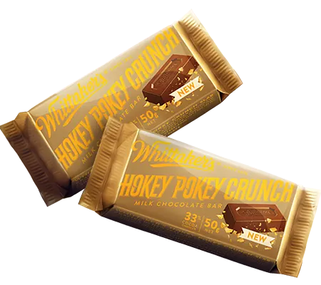

**I'm on the hunt to collect every Flesh and Blood puzzle piece.**

> "Next stop, World Championship Paris 2026! If you have a puzzle piece that I'm missing, you can redeem it with me for a beautifully crafted, delicious slab of genuine New Zealand Whittaker's Chocolate." - JJScott

## GEM Pack #6

_Images unavaliable_

## Usurp the Shadow Throne World Premiere

_Images unavaliable_

## Tournament Pack Wave #2









## GEM Pack #5








## Tournament Pack Wave #1









## Antiquity Pack (Compendium of Rathe)







## Ruu'di, Gem Keeper

_Images unavaliable_

## GEM Pack #4








## Judge Pack #9

_Images unavaliable_

## GEM Pack #3








## Mastery Pack Guardian





## Treasure Pack (High Seas)






## GEM Pack #2








## GEM Pack #1








## Rosetta







